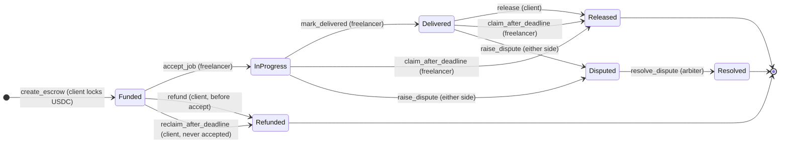

<div align="center">


<br>

[](https://mohar-beta.vercel.app)
[](https://explorer.solana.com/address/Ey5QSYnyD4GokFS3H8hiwMyrRVZEbzXnjaRPY6DdAtMQ?cluster=devnet)
[](https://www.anchor-lang.com)
[](#testing)
[](#security)
[](LICENSE)

**[Open the app](https://mohar-beta.vercel.app)** · **[User guide](docs/USER_GUIDE.md)** · **[How it works](docs/ARCHITECTURE.md)** · **[Run it locally](docs/DEVELOPMENT.md)** · **[FAQ and troubleshooting](docs/FAQ.md)**

</div>

---

Mohar (मोहर, "seal" or "stamp" in Nepali) is an on-chain escrow for freelancers who work with international clients. The client locks USDC in a vault that only the program controls. The freelancer accepts the job and delivers. The money moves when the deal does. There is no custodian, no platform cut, and no *"I'll pay you next week"*.

> [!IMPORTANT]
> Mohar runs on **Solana devnet with test USDC only**. It has had a manual security review, not an audit. Do not use it with real money. See [Security](#security).

## Contents

- [The problem](#the-problem)
- [How a deal works](#how-a-deal-works)
- [Try it in five minutes](#try-it-in-five-minutes)
- [Why on-chain](#why-on-chain)
- [Stack and deployment](#stack-and-deployment)
- [Repository layout](#repository-layout)
- [Run it locally](#run-it-locally)
- [Testing](#testing)
- [Security](#security)
- [Not in v1](#not-in-v1)
- [Documentation](#documentation)
- [License](#license)

## The problem

Cross-border freelance work runs on trust. The client sends a deposit, or they don't. The freelancer starts the work, or they don't. When something goes wrong (late payment, a ghosted client, a disputed scope), the freelancer has no leverage. Marketplaces take a cut and resolve disputes slowly. Direct-client work, where margins are best, has no protection at all.

Mohar replaces that trust gap with a program. The rules are written down in code, both sides can read them, and neither side can break them.

## How a deal works

Three people can be named on an escrow, and each one has a clear job.

| Role | Who they are | What they can do |
|---|---|---|
| **Client** | Pays for the work | Create the escrow and lock USDC. Refund before the freelancer accepts. Release payment after delivery. Raise a dispute. Reclaim the funds if the deadline passes and the job was never accepted. |
| **Freelancer** | Does the work | Accept the job. Mark it delivered. Raise a dispute. Claim the funds if the deadline passes and the client stays silent. |
| **Arbiter** | A neutral third party both sides trust | Does nothing unless a dispute is raised. Then decides whether the freelancer is paid or the client is refunded. |

The freelancer and the arbiter are named on the escrow, on chain, when the client creates it. They cannot be swapped later.

### The deal path



Read it left to right:

1. **Funded.** The client creates the escrow. The USDC leaves the client's wallet and sits in the vault. The deal is not live yet.
2. **In Progress.** The freelancer accepts. From this moment the client can no longer cancel on their own.
3. **Delivered.** The freelancer marks the work as delivered.
4. **Released.** The client checks the work and releases payment. The USDC goes to the freelancer's wallet.

The other paths are the safety nets:

| Situation | What happens |
|---|---|
| The client changes their mind before the freelancer accepts | The client can **refund** and get the USDC back. |
| The freelancer never accepts and the deadline passes | The client can **reclaim** the funds. |
| The client goes silent after the job is accepted or delivered, and the deadline passes (and nobody disputed) | The freelancer can **claim** the full amount. No support ticket. |
| The work is not right | Either side can **raise a dispute** before the deadline. Everything freezes until the arbiter decides. |

Every transition is a program instruction. Every state change is on chain. There is no off-chain escrow database: the program is the source of truth, and the app re-reads it after every transaction.

## Try it in five minutes

**No install, no clone, no build.** Open **[mohar-beta.vercel.app](https://mohar-beta.vercel.app)**. The app is already running and talks to the live devnet program. There is also a **How to use Mohar** guide in the app footer, and a longer one in [docs/USER_GUIDE.md](docs/USER_GUIDE.md).

### What you need

| | |
|---|---|
| Browser | Chrome, Brave, Firefox or Edge |
| Wallet | [Phantom](https://phantom.app) or [Solflare](https://solflare.com) browser extension |
| Network | Wallet switched to **Devnet** (Phantom: Settings → Developer Settings → Testnet Mode → Devnet) |
| Devnet SOL | For transaction fees. [faucet.solana.com](https://faucet.solana.com): paste your wallet address and request an airdrop |
| Devnet USDC | The escrow currency. [faucet.circle.com](https://faucet.circle.com): choose **Solana Devnet**, paste your address, claim |

### Walk through a full deal

> [!TIP]
> You can play all three roles yourself. Create several wallets inside one wallet extension and switch between them.

1. **Create.** Connect as the **client**. Enter the freelancer's address, an arbiter's address, a small amount of USDC and a deadline. Approve the transaction. The escrow shows as **Funded** on your dashboard.
2. **Accept.** Switch to the **freelancer** wallet and click **Accept job**. The status becomes **In Progress**, and the client can no longer cancel.
3. **Deliver.** Click **Mark Delivered**. The status becomes **Delivered**.
4. **Release.** Switch back to the **client** and click **Release**. The status becomes **Released** and the USDC is in the freelancer's wallet.

Every step is visible on [Solana Explorer](https://explorer.solana.com/?cluster=devnet). Paste the escrow address or any transaction signature to watch the state change. Each escrow also has a shareable link: `/escrow/<address>`.

Want to see the dispute, refund, claim and reclaim paths? They are covered step by step in the [user guide](docs/USER_GUIDE.md).

### Check that the program exists

Any Solana explorer works, or:

```bash
solana program show Ey5QSYnyD4GokFS3H8hiwMyrRVZEbzXnjaRPY6DdAtMQ --url devnet
```

## Why on-chain

- **The money is not with a company.** The funds sit in a vault owned by a program-derived address (PDA). The rules are the program.
- **Neither side can cheat the state machine.** Neither party can move the money outside it, and neither can force a payout the other did not agree to.
- **A silent client cannot hold the freelancer hostage.** After the deadline, the freelancer can claim without asking anyone.
- **A freelancer cannot just take the money and disappear.** If the work is not done, the client can dispute before the deadline, which freezes everything until the arbiter decides.
- **Anyone can check.** The program, every escrow and every transition can be read on a public explorer.

## Stack and deployment

| | |
|---|---|
| Program | Rust, Anchor 0.32.1 |
| Chain | Solana |
| Token | USDC (SPL, 6 decimals) |
| Frontend | React, Vite, TypeScript |
| Wallets | Phantom, Solflare |
| Profiles and auth | Supabase (magic link, PKCE). Optional |
| Tests | LiteSVM (25 scenarios, in-process) and 15 devnet integration tests |

**Live deployment**

| | |
|---|---|
| Cluster | Devnet |
| Program ID | [`Ey5QSYnyD4GokFS3H8hiwMyrRVZEbzXnjaRPY6DdAtMQ`](https://explorer.solana.com/address/Ey5QSYnyD4GokFS3H8hiwMyrRVZEbzXnjaRPY6DdAtMQ?cluster=devnet) |
| USDC mint | `4zMMC9srt5Ri5X14GAgXhaHii3GnPAEERYPJgZJDncDU` (Circle devnet) |
| App | [mohar-beta.vercel.app](https://mohar-beta.vercel.app) |

**Devnet only. Not on mainnet.**

## Repository layout

```text
programs/mohar/          Anchor program (single crate)
app/                     React + Vite frontend
  src/pages/             Landing, Dashboard, CreateEscrow, EscrowDetail,
                         Profile, Guide, Privacy, Terms
  src/components/        Wallet button, connect modal, confirm dialogs, shared UI
  src/lib/               Anchor client, IDL, config, router, Supabase client
mohar-litesvm/           Program test suite (LiteSVM, no validator required)
supabase/                Database migrations (profiles)
brand/                   Logo assets
docs/                    User guide, architecture, development, FAQ
```

## Run it locally

You only need this if you want to change the code. To use Mohar, open the live app.

**Prerequisites:** Rust stable 1.97.1 or newer, Solana CLI 4.x, Anchor CLI 0.32.1 (via `avm`), Node.js 20 or newer. Full instructions are in [docs/DEVELOPMENT.md](docs/DEVELOPMENT.md).

```bash
git clone https://github.com/UrbishCodes/mohar.git
cd mohar

# 0. Update Rust first. If the build fails, run this before anything else.
rustup update

# 1. Run the program test suite
cd mohar-litesvm
cargo test
cd ..

# 2. Install and run the frontend
cd app
npm install --ignore-scripts
npm run dev
```

The dev server prints a local URL, usually `http://localhost:5173`. Open it, connect a wallet, switch to devnet, and you are in.

> [!WARNING]
> Use `npm install --ignore-scripts`, **not** `npm ci`. Two transitive dependencies (`@stellar/stellar-sdk` and `@keystonehq/sdk`) run `yarn` in their postinstall scripts, and `yarn` is not installed by default, so `npm ci` fails. The flag skips those hooks. Nothing the app uses depends on them.

Profiles and the Helius RPC key are optional. Without Supabase keys the Profile page says "not configured" and everything else works. Without a Helius key the app uses the public devnet endpoint. Details are in [docs/DEVELOPMENT.md](docs/DEVELOPMENT.md#environment-variables).

## Testing

| Suite | What it is | Run it |
|---|---|---|
| **LiteSVM** | 25 tests, in-process, no validator needed. Covers every instruction (including the accept handshake, deadline claim and reclaim, and the dispute paths), PDA derivation, vault funding and closure, mint constraints, signer checks, unauthorized-action rejections, wrong-destination rejections and double-spend protection. | `cd mohar-litesvm && cargo test` |
| **Devnet integration** | 15 tests against the live devnet program, in `tests/mohar.ts`. | Needs a funded devnet wallet and network access |

The program has also been exercised end to end on devnet with real wallets and real Circle USDC across the full lifecycle, plus the dispute, refund, claim and reclaim paths.

## Security

> [!CAUTION]
> The program has had a **manual security review, not an audit.** Read that literally. The logic is small and the test surface is broad, but there has been no third-party audit and the code is not production-hardened. **Do not deploy to mainnet without a proper audit.**

The program is **upgradeable**: the holder of its upgrade authority can change the program's rules. The upgrade authority keypair is not in this repository and is not committed anywhere.

If you find a vulnerability, please report it privately to the maintainers instead of opening a public issue.

## Not in v1

- Mainnet deployment.
- Milestone-based partial releases (on the roadmap).
- Multi-token support. USDC only in v1.
- On-chain reputation, notifications, a mobile app and a fiat off-ramp.

## Documentation

| Document | Read it if you want to |
|---|---|
| [User guide](docs/USER_GUIDE.md) | Use Mohar as a client, freelancer or arbiter, step by step |
| [Architecture](docs/ARCHITECTURE.md) | Understand the accounts, instructions, state machine and how the app reads the chain |
| [Development](docs/DEVELOPMENT.md) | Set up the toolchain, run the app, run the tests, change the code |
| [FAQ and troubleshooting](docs/FAQ.md) | Fix a wallet, network or transaction problem, or get a quick answer |

## License

Apache-2.0. See [LICENSE](LICENSE). The Mohar name and brand assets are not covered by the license grant.
