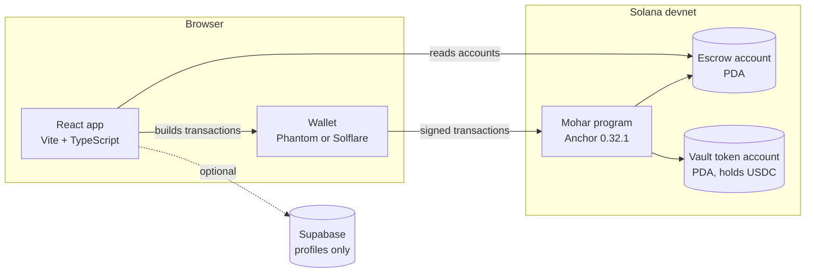
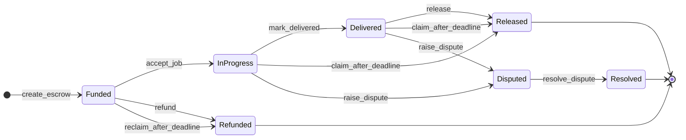

# Mohar architecture

This document explains how Mohar works under the hood: the pieces, the on-chain accounts, the instructions, the state machine, and how the app reads the chain. It is for developers, reviewers and anyone who wants to check the rules for themselves. If you only want to use Mohar, read the [user guide](USER_GUIDE.md).

**On this page**

1. [The pieces](#1-the-pieces)
2. [On-chain accounts](#2-on-chain-accounts)
3. [Instructions](#3-instructions)
4. [The state machine](#4-the-state-machine)
5. [Errors](#5-errors)
6. [Why the money is safe](#6-why-the-money-is-safe)
7. [How the frontend works](#7-how-the-frontend-works)
8. [Configuration](#8-configuration)
9. [Trust assumptions and limits](#9-trust-assumptions-and-limits)

> [!NOTE]
> The program source in `programs/mohar/src` is the source of truth. This document describes it. If the two ever disagree, the code wins, and this file should be fixed.

---

## 1. The pieces



| Piece | Job |
|---|---|
| **Program** (`programs/mohar`) | Holds the rules. Creates escrows, moves USDC in and out of the vault, and enforces who may do what and when. |
| **Escrow account** | One per deal. Stores the parties, the amount, the deadline and the status. |
| **Vault** | A token account that holds the USDC for one escrow. Its authority is the escrow PDA, so only the program can move the money. |
| **Frontend** (`app`) | Reads escrows from the chain, builds transactions, and asks the wallet to sign them. It has no authority of its own. |
| **Wallet** | Holds each person's keys. Every state-changing action needs the right wallet to sign. |
| **Supabase** | Optional. Stores display profiles only. It is not part of any money flow. |

There is **no off-chain escrow database**. If the app disappeared, every escrow would still exist on chain and could be operated with any other client.

---

## 2. On-chain accounts

### 2.1 Escrow

One escrow account exists per deal. Fields:

| Field | Type | Meaning |
|---|---|---|
| `client` | `Pubkey` | The wallet that locked the USDC |
| `freelancer` | `Pubkey` | The wallet that is paid on release |
| `arbiter` | `Pubkey` | The wallet that settles a dispute |
| `mint` | `Pubkey` | The token mint (USDC) |
| `seed` | `u64` | A number the client chooses, so one client can have many escrows |
| `amount` | `u64` | The locked amount in the token's smallest unit (USDC has 6 decimals, so `1_000_000` is 1 USDC) |
| `deadline` | `i64` | A Unix timestamp in seconds |
| `status` | `EscrowStatus` | Where the deal is in its life (see [section 4](#4-the-state-machine)) |
| `bump` | `u8` | PDA bump for the escrow |
| `vault_bump` | `u8` | PDA bump for the vault |

### 2.2 Addresses (PDAs)

Both accounts are program-derived addresses, so nobody holds a private key for them.

| Account | Seeds |
|---|---|
| Escrow | `[b"escrow", client, seed.to_le_bytes()]` |
| Vault | `[b"vault", escrow]` |

The vault is an SPL token account whose **authority is the escrow PDA**. Only the program can sign for that PDA, and it signs only inside the instructions below.

Anyone can recompute an escrow address from the client's address and the seed, which is how the app finds and shares escrows (`/escrow/<address>`).

---

## 3. Instructions

Every instruction checks the signer and the current status before it does anything.

| Instruction | Signer | Allowed when | Effect | New status |
|---|---|---|---|---|
| `create_escrow(seed, amount, deadline)` | Client | `amount` is above zero and `deadline` is in the future | Creates the escrow and vault, moves `amount` of USDC from the client into the vault | **Funded** |
| `accept_job` | Freelancer | Status is Funded | Marks the deal live. The client can no longer refund. | **In Progress** |
| `mark_delivered` | Freelancer | Job is accepted | Records that the freelancer says the work is done | **Delivered** |
| `release` | Client | Status is Delivered | Pays the full amount to the freelancer, closes the vault, returns the vault's rent to the client | **Released** |
| `refund` | Client | Status is Funded (before accept) | Pays the full amount back to the client, closes the vault | **Refunded** |
| `reclaim_after_deadline` | Client | Deadline has passed and the job was never accepted | Pays the full amount back to the client, closes the vault | **Refunded** |
| `claim_after_deadline` | Freelancer | Deadline has passed, job accepted, no dispute | Pays the full amount to the freelancer, closes the vault | **Released** |
| `raise_dispute` | Client or freelancer | Job is In Progress or Delivered | Freezes the deal | **Disputed** |
| `resolve_dispute(pay_freelancer)` | Arbiter | Status is Disputed | Pays the full amount to the freelancer if `pay_freelancer` is true, otherwise to the client. Closes the vault. | **Resolved** |

Notes:

- The client, freelancer and arbiter checks use the addresses stored on the escrow (Anchor `has_one` constraints), so a different wallet cannot act in their place.
- Payouts always go to a token account owned by the intended recipient. A token account owned by anyone else is rejected.
- Every payout sends the **full** amount. There are no partial releases and no fees taken by the program.
- When a deal ends, the vault is closed, so a finished escrow cannot be paid out a second time.

---

## 4. The state machine



Three statuses are **final**: Released, Refunded and Resolved. Once there, nothing can move the money again.

### Who can do what, by status

| Status | Client | Freelancer | Arbiter |
|---|---|---|---|
| Funded | `refund`, `reclaim_after_deadline` (after deadline) | `accept_job` | none |
| In Progress | `raise_dispute` | `mark_delivered`, `raise_dispute`, `claim_after_deadline` (after deadline) | none |
| Delivered | `release`, `raise_dispute` | `raise_dispute`, `claim_after_deadline` (after deadline) | none |
| Disputed | none | none | `resolve_dispute` |
| Released, Refunded, Resolved | none | none | none |

### The deadline

The deadline does two things and only two:

1. After it passes on an **unaccepted** escrow, the client may reclaim.
2. After it passes on an **accepted** escrow with no dispute, the freelancer may claim.

A dispute raised **before** the deadline blocks both. That is why the client's protection against a freelancer who has not delivered is to dispute in time.

---

## 5. Errors

When a transaction is rejected, the program returns one of these:

| Error | Meaning |
|---|---|
| `InvalidAmount` | The amount is zero or less |
| `InvalidDeadline` | The deadline is not in the future |
| `InvalidStatus` | The escrow is not in a state that allows this action |
| `DeadlineNotReached` | The deadline has not passed yet |
| `Unauthorized` | The signer is not a party allowed to act, or the client account does not match |
| `InvalidDestination` | A token account is not owned by the intended recipient |

The app turns these into plain-language messages. See the [FAQ](FAQ.md) for what to do about each.

---

## 6. Why the money is safe

- **No one holds the vault key.** The vault is owned by the escrow PDA. Only the program can sign for it, and only inside the instructions above.
- **The rules cannot be skipped.** Each instruction checks the signer and status. The program has 25 in-process tests that try the wrong signer, the wrong status, the wrong destination and a double payout.
- **Roles are fixed at creation.** The freelancer and arbiter are written into the escrow when it is created.
- **Payouts are all-or-nothing.** The full amount moves to one named party and the vault closes.
- **The state is public.** Anyone can read the escrow account and recompute its address.

---

## 7. How the frontend works

```text
app/src/
  pages/        Landing, Dashboard, CreateEscrow, EscrowDetail,
                Profile, Guide, Privacy, Terms
  components/   Wallet button, connect modal, confirm dialogs, shared UI
  lib/          Anchor client, IDL, config, router, Supabase client
```

**Reading.** The Dashboard and the escrow page read escrow accounts straight from the chain through the Anchor client and the program's IDL. A page then works out your role (client, freelancer, arbiter or viewer) by comparing your wallet address with the three addresses on the escrow.

**Writing.** Each button builds one program instruction, asks your wallet to sign it, sends it, and waits for confirmation. After a confirmed transaction the app **re-reads the escrow**, so the screen always reflects the chain and not a guess.

**Routing.** Each escrow has a shareable path, `/escrow/<address>`.

**Buttons follow the state machine.** Only the actions that are valid for your role and the current status are offered. The program enforces the same rules, so a stale screen can never move money the rules forbid.

**Profiles** use Supabase with a magic-link, PKCE sign-in. They are separate from the escrow and optional.

**RPC.** The app uses a Helius devnet endpoint when a key is configured, and the public devnet endpoint otherwise.

---

## 8. Configuration

| Setting | Where | Purpose |
|---|---|---|
| `VITE_SUPABASE_URL`, `VITE_SUPABASE_ANON_KEY` | `app/.env` | Enable profiles. Public by design: they ship in the frontend bundle. |
| `VITE_HELIUS_API_KEY` | `app/.env` | Use a Helius devnet RPC. If unset, the public devnet endpoint is used. |
| `mohar:mint` | Browser `localStorage` | Point the app at a different USDC mint (see [Development](DEVELOPMENT.md#using-a-different-usdc-mint)) |

---

## 9. Trust assumptions and limits

| | |
|---|---|
| **Upgradeable program** | The holder of the upgrade authority can change the rules. That key is not in the repository. Before any real use, it should be burned or moved to a multisig. |
| **Not audited** | There has been a manual security review, not a third-party audit. |
| **Arbiter is a person** | The arbiter's decision is final and covers the whole amount. Choosing the arbiter is the most important decision on an escrow. |
| **Delivery is a claim** | The program records that the freelancer marked the work delivered. It cannot judge the work itself. That is what the dispute path is for. |
| **Devnet only** | Test USDC from the Circle devnet faucet. Not deployed to mainnet. |
| **USDC only, full amounts only** | No other tokens and no partial or milestone releases in v1. |
